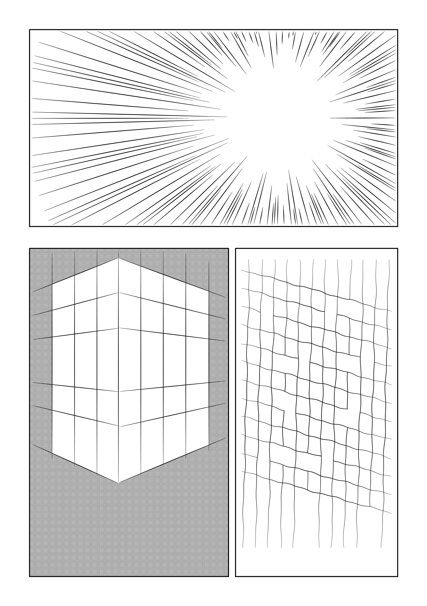
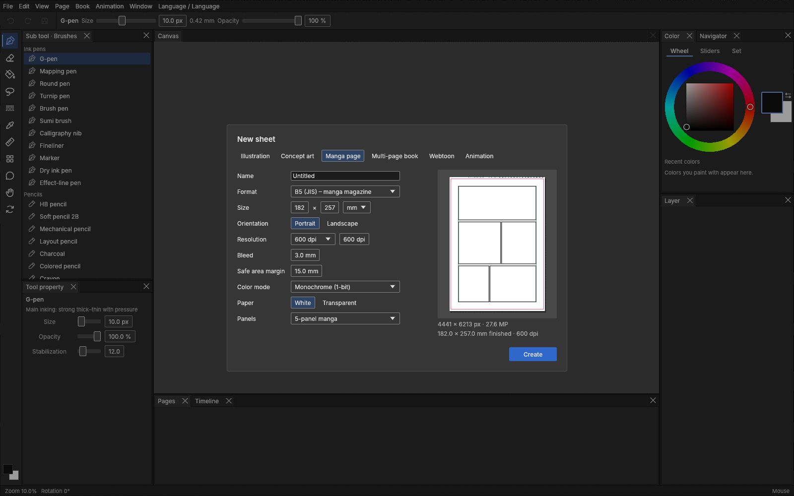
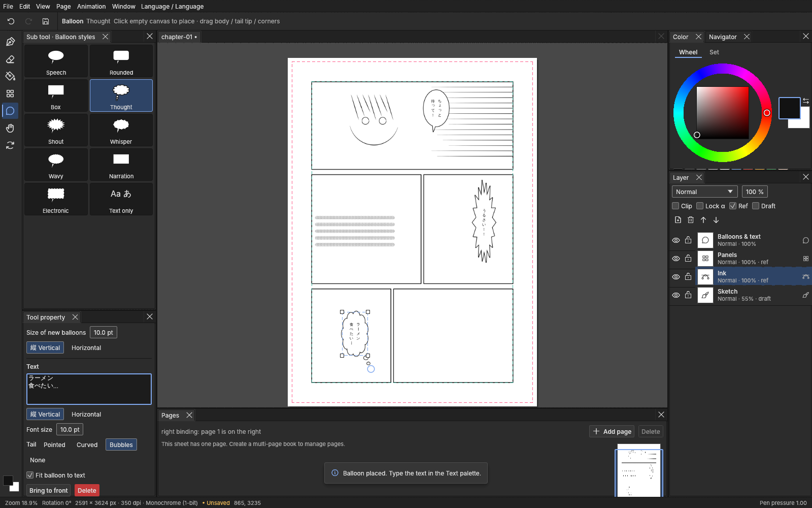
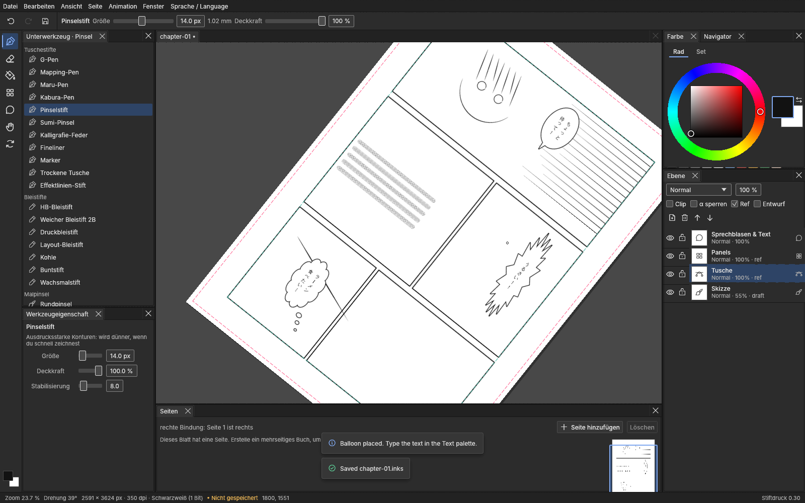
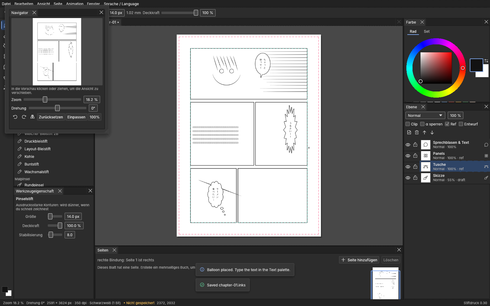
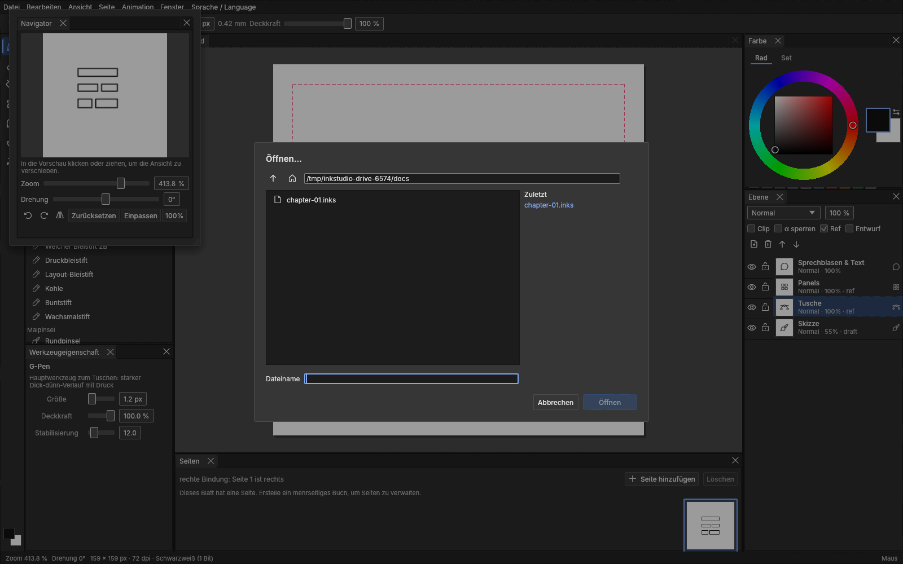
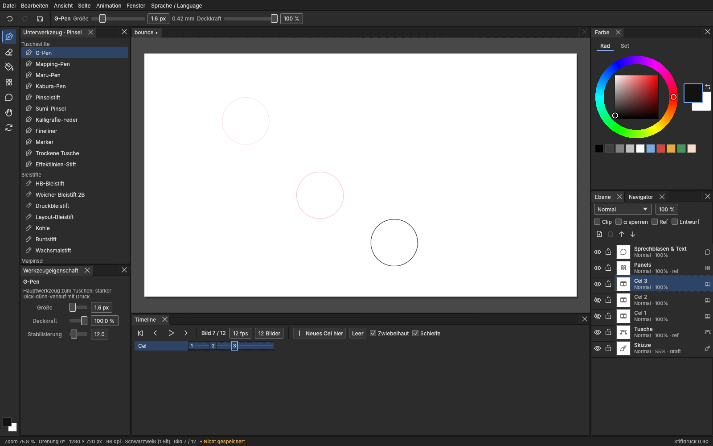
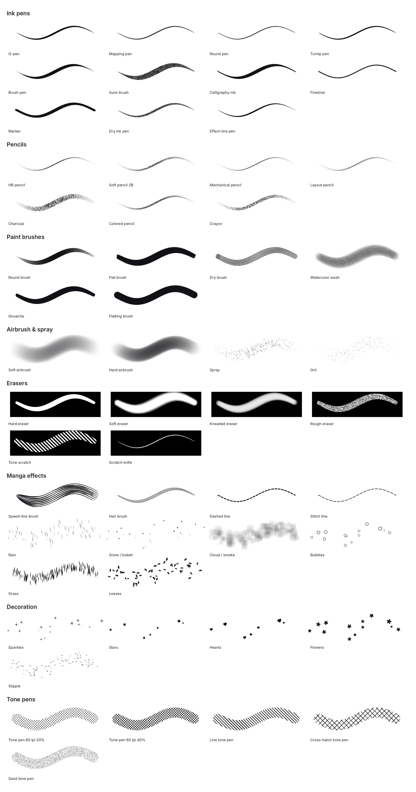

# Inkstudio

A native desktop drawing app for manga and comic artists, written in Rust. It is built for fast inking, real print output (screentones, 1-bit, bleed/trim) and large pages that stay smooth.

> Status: **early but usable.** The app window, drawing engine, panels, balloons, multi-page books, animation, project files, dockable palettes, free canvas rotation and an English/German UI work and are tested. See `replica/` for the plan.



*A B4 page at 600 dpi (6071 × 8598 px) drawn entirely by the engine:*
- *Panel 1: focus lines with the focus ruler.*
- *Panel 2: a building on a two-point perspective ruler, a gap-closing fill that refers to the line art, and a 60 lpi screentone clipped to it.*
- *Panel 3: a vector cross-hatch cleaned with "erase up to intersection".*

## The app

```sh
cargo run --release -p inkstudio
```

| | |
| --- | --- |
|  |  |
| **New sheet**: illustration, manga page, multi-page book, webtoon or animation. Paper formats (B5/B4 JIS, A4/A5, B6, US comic, Letter, webtoon, HD…) or a custom size in mm/px/in, DPI, bleed, safe area, color mode, paper, pages and binding, panel template, fps and length, with a live preview. | **Balloon tool**: pick from 10 styles, click to place, type the text (vertical 縦 or horizontal), drag the body, the tail tip or the corners. |
|  |  |
| **Rotate, mirror, zoom, pan anywhere.** German UI shown. | **Dockable palettes**: drag any tab to dock, split or float it. The layout is remembered. |
|  |  |
| **Save and open `.inks` projects** with recent files and an unsaved-changes prompt. | **Animation**: timeline, cels, holds, onion skin, GIF export. |

### Canvas navigation

| action | how |
| --- | --- |
| Pan | Hand tool (H), hold Space, or middle-drag; mouse wheel / two-finger scroll; arrow keys (Shift = faster); drag in the Navigator |
| Zoom | Ctrl/Cmd + wheel, pinch, `+` / `−`, `1` = 100 %, Ctrl+0 = fit, Navigator slider (1–3200 %) |
| Rotate | Rotate tool or hold R and drag, two-finger twist, `4` / `6` = ±15°, `5` = reset, Navigator slider |
| Mirror | `M` or the Navigator flip button (only the view is mirrored, not the drawing) |

Zoom, rotation and mirroring keep the point under the cursor in place. Drawing, balloons and panels all work on a rotated or mirrored canvas.

### Pen tablets

| platform | how pressure gets in |
| --- | --- |
| Windows | Windows Ink through winit |
| macOS | `NSEvent` local monitor reads pressure and tilt of tablet events (Wacom, Huion, XP-Pen, Sidecar) before winit sees them |
| Linux X11 | XInput2 motion valuators ("Abs Pressure", "Abs Tilt X/Y") on our own X connection |
| Linux Wayland | `zwp_tablet_v2` on the app's display; samples also drive the UI pointer, because compositors stop emulating it for tablet clients |

The backends live in `ink-tablet`. They feed samples into egui as pen events with force, the same shape Windows Ink uses. A pen contact whose pointer event arrives a moment earlier simply continues as a pressure stroke. The status bar shows which backend is active.

> Tested here: unit tests for each backend's data handling, the macOS backend compiles for `aarch64-apple-darwin`, and the X11 backend attaches to a real window under Xvfb (also in CI). Not yet tested on physical tablets on macOS or Linux. Please report how your tablet behaves.

### Autosave and recovery

- Every 1, 3 (default), 5 or 10 minutes, or off (*File → Autosave*). The snapshot takes almost no time on the UI thread, because tiles are shared copy-on-write. Writing happens on a background thread.
- Autosave writes a recovery copy. Optionally it also writes the project file. A book is only marked saved if nothing changed while it was being written.
- After a crash, the next start offers each unsaved work: *Recover*, *Discard* or *Later*. Saving or choosing *Don't save* removes the copy.

### Layouts

| layout | for |
| --- | --- |
| Standard | everything visible |
| Manga & inking | brushes left, big layer list right, page strip below |
| Lettering & balloons | wide balloon picker and a tall text editor |
| Animation | tall timeline, color and cels on the right |
| Illustration & painting | large color palette, no page strip or timeline |
| Canvas focus | maximum canvas, one tab stack |

*Window → Layouts*: each layout remembers its own arrangement. *Save layout as…* creates your own, and *Reset layout* restores a built-in default. With *Switch layout by sheet type* on, opening a manga page, book, animation or illustration switches to its layout, and the app remembers your last choice per sheet type.

### Files, palettes, languages

- **Project files (`.inks`)**: SQLite with LZ4-compressed tiles. Stores every page, layer, panel, balloon and the animation timeline. Saving writes a new file and swaps it in, so a crash can't corrupt a project. Ctrl+S / Ctrl+Shift+S / Ctrl+O, recent files, a • marker and a prompt for unsaved changes (also when closing the window).
- **Dockable palettes**: Sub tool, Tool property, Color, Layer, Navigator, Pages and Timeline are tabs you can drag to dock, split, stack or float. *Window* shows or hides them; *Reset layout* restores the default. The layout is saved in the settings.
- **English / Deutsch**: *Language* menu. It follows the system language by default and is remembered. A test fails if any UI string lacks a German translation.

- **Pen input.** Every pen sample of a frame is used, not just one per frame. Pressure works on Windows, macOS, X11 and Wayland (see *Pen tablets*). For a mouse, *View → Simulate pressure for mouse* derives pressure from speed.
- **Canvas.** GPU tiles with 4 levels of detail: only visible tiles are uploaded, and only changed tiles are refreshed. Wheel/pinch zoom at the cursor, Space or middle-drag to pan.
- **Tools.** 54 brushes and erasers, fill (refer to line art, close gaps), panel frames (draw, divide with gutter, 7 templates), balloons and text, hand.
- **Layers.** Blend modes, opacity, clipping, alpha lock, reference and draft layers, add/delete/reorder. Everything is undoable, including panel and balloon edits.
- **Export.** PNG per page in color, grayscale or true 1-bit, and animated GIF.

`cargo run --release -p inkstudio --example drive` drives the real UI headless. It switches layouts, saves a user layout, autosaves, simulates a crash and recovers, and also draws with synthetic pen events (pressure), places balloons with mouse clicks, types Japanese text with key events, drags a tail, saves with Ctrl+S through the file dialog, switches to German, rotates and mirrors the view and keeps drawing, floats a palette, triggers the unsaved-changes prompt, reopens the file with Ctrl+O in a fresh app and checks the content, builds an animation, exports, and writes the screenshots above.

## What makes it a manga tool

| feature | where | status |
| --- | --- | --- |
| Pen feel: pressure curves, stabilization + post-correction, start/end taper, stroke buffer (overlapping dabs never exceed the stroke's opacity) | `ink-raster::brush` | engine ✔ |
| G-pen, mapping pen, pencil, airbrush and eraser presets | `ink-raster::brush` | engine ✔ |
| Vector layers: editable strokes drawn with the same brush engine; line width correction | `ink-vector::stroke` | engine ✔ |
| Vector eraser: touched part / **up to intersection** / whole line | `ink-vector::stroke` | engine ✔ |
| Fill that refers to other layers, closes gaps in line art and grows under the lines | `ink-raster::fill` | engine ✔ |
| Screentones: LPI, density (calibrated per dot shape), angle, 6 dot shapes, 1-bit print output | `ink-raster::tone` | engine ✔ |
| Rulers: perspective 1/2/3-point, parallel, focus lines, concentric, straight, symmetry (rotational and mirror) | `ink-vector::ruler` | engine ✔ |
| Layers: blend modes, opacity, clipping, alpha lock, reference and draft layers, copy-on-write undo | `ink-core` | engine ✔ |
| **54 brushes**, manga first: ink pens, pencils, paint, airbrush, erasers, manga effects, decoration, tone pens | `ink-raster::presets` | engine ✔ |
| Brush engine options: tip shapes (round, flat/chisel, square, star, heart, flower, ring, multi-line), paper grain, scatter, speed → size, follow stroke direction, dashes, paint-with-screentone | `ink-raster::{brush, tip}` | engine ✔ |
| Panel frames: draw, divide with gutters, templates (1, 2, 3 rows, 4-koma, 2×2, 2×3, 5-panel) | `ink-comic::panel` | app ✔ |
| Speech balloons: 10 styles, pointed/curved/bubble tails merged cleanly with the body | `ink-comic::balloon` | app ✔ |
| Lettering: vertical Japanese (columns right-to-left, rotated ー〜…, 。、 placement, small kana) and horizontal, font fallback | `ink-comic::text` | app ✔ |
| Multi-page books with binding direction | `inkstudio::book` | app ✔ |
| Animation: cels, holds, blanks, onion skin, playback, GIF | `ink-anim` | app ✔ |
| Project files (.inks), dockable palettes, rotate/mirror view, English/German | `ink-io`, `inkstudio` | app ✔ |
| Pen pressure on macOS, X11, Wayland; autosave + crash recovery; workspace layouts | `ink-tablet`, `inkstudio` | app ✔ |
| 3D mannequin, material packs, rulers in the UI | `replica/architecture.md` | planned |

## Brushes



| category | brushes |
| --- | --- |
| Ink pens | G-pen, mapping pen, round pen, turnip pen, brush pen (thins when fast), sumi brush, calligraphy nib, fineliner, marker, dry ink pen, effect-line pen |
| Pencils | HB, soft 2B, mechanical, layout pencil, charcoal, colored pencil, crayon |
| Paint | round, flat, dry brush (bristle lines), watercolor wash, gouache, flatting brush |
| Airbrush & spray | soft, hard, spray, grit |
| Erasers | hard, soft, kneaded, rough, tone scratch (erases in a line pattern), scratch knife |
| Manga effects | speed-line brush (many parallel lines in one stroke), hair strands, dashed line, stitches, rain, snow/bokeh, cloud/smoke, bubbles, grass, leaves |
| Decoration | sparkles, stars, hearts, flowers, stipple |
| Tone pens | dot tone 20% / 40%, line tone, cross-hatch tone, sand tone. They paint the screentone pattern directly |

Every preset costs **≤ 0.2 ms per pen sample** (most 0.003–0.07 ms), measured with
`cargo run --release -p ink-raster --example brush_sheet`.

## Performance

Measured on 4 CPU cores, B4 at 600 dpi (52 MP), release build (`cargo run --release -p ink-vector --example showcase`):

| operation | time |
| --- | --- |
| One pen sample, G-pen (stamp + recomposite of the changed rectangle) | 0.06–0.12 ms |
| Recomposite one dirty tile for display | 0.07 ms |
| Fill with "refer to line art" + 6 px gap closing, whole page | ~0.43 s |
| 60 lpi screentone over a quarter page | ~0.1–0.2 s |
| Full-page composite (816 tiles, parallel) | ~0.08 s |
| Flatten whole page for export | ~0.08 s |
| Undo / redo of any step | < 0.1 ms |

How:
- **Sparse 256 px tiles.** Empty areas cost nothing.
- **Copy-on-write tiles shared through `Arc`.** An undo step stores pointers to the old tiles, not pixels.
- **Per-stroke coverage buffer.** Recompositing covers only the changed rectangle, written in place.
- **Fill passes are linear time.** Tile-based barrier mask, sliding-window dilation in parallel row bands, and growth seeded only at the region outline.
- **rayon** runs compositing, tones, fill and export in parallel.
- Pixel crates are built with `opt-level = 3` even in dev builds.

## Workspace

```
crates/
  ink-core     tiles, layers, blend modes, compositing, undo
  ink-raster   brushes + stabilizer, fill, screentones
  ink-vector   vector strokes + eraser, rulers
  ink-comic    panel frames, speech balloons, horizontal/vertical lettering
  ink-anim     timeline, cels, onion skin, GIF export
  ink-io       .inks project files (SQLite + LZ4 tiles)
  ink-tablet   pen pressure/tilt on macOS (NSEvent), X11 (XInput2), Wayland (tablet-v2)
  ink-ui       design tokens, theme and egui widgets (see replica/design)
  inkstudio    the app: window, canvas, pen input, tools, palettes, dialogs
replica/       recon, architecture, schema, design system, feature matrix
```

## Build and test

```sh
cargo test --workspace
cargo run --release -p ink-vector --example showcase -- replica/showcase.png
cargo run --release -p ink-ui --example design_gallery -- replica/design 2
```

Requires Rust 1.95+ (2024 edition).

## License

MIT. Inkstudio is an original implementation. It contains no code, assets, file formats or artwork from Clip Studio Paint or Krita.
